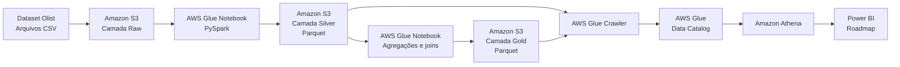
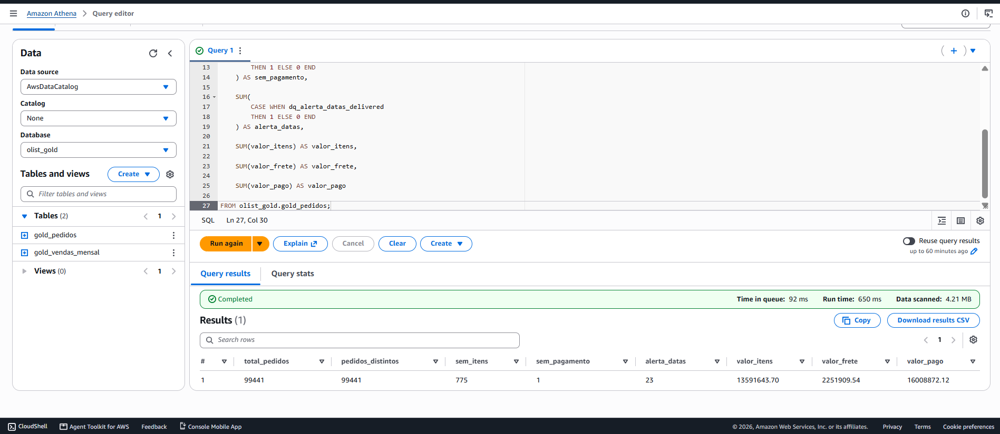
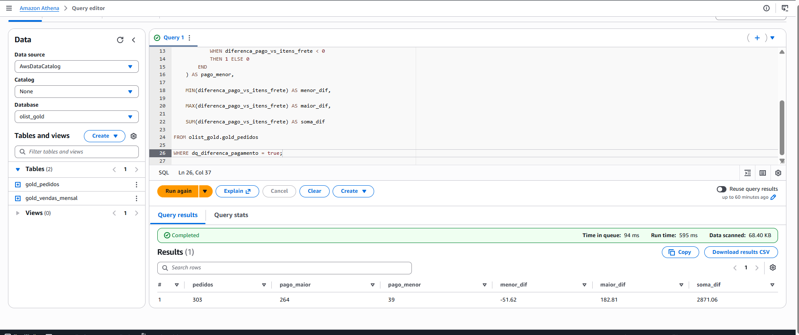
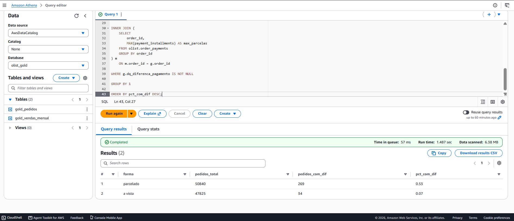
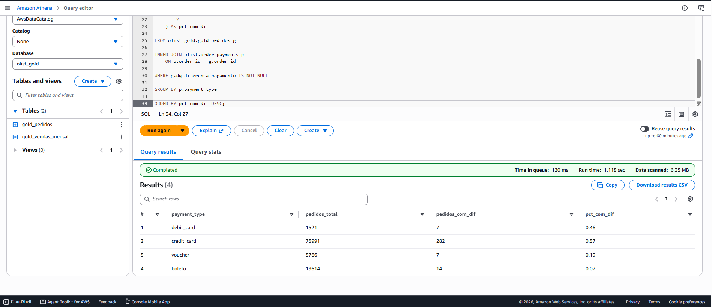
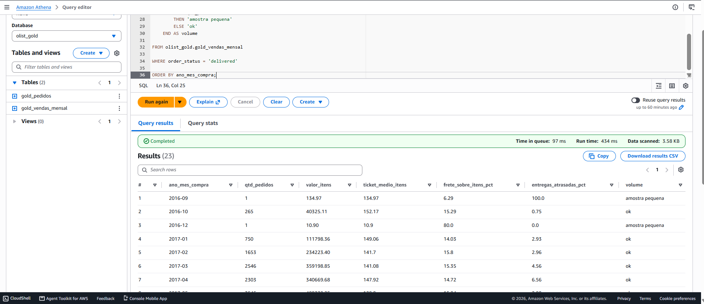

# AWS Retail Lakehouse — Olist

Pipeline de Engenharia de Dados desenvolvido na AWS para processar dados públicos de e-commerce da Olist.

O projeto implementa uma arquitetura em camadas, realizando ingestão de arquivos CSV, tratamento com PySpark, armazenamento em Parquet, catalogação dos dados e criação de tabelas analíticas consultadas pelo Amazon Athena.

```text
CSV bruto → Amazon S3 → AWS Glue/PySpark → Silver Parquet
                                         ↓
                                    Gold Parquet
                                         ↓
                              Glue Data Catalog
                                         ↓
                                  Amazon Athena
```

> **Status do projeto:** Release 1 concluída.  
> Carga completa em Parquet, validações de qualidade, reconciliação entre camadas e tabelas Gold para análise.

---

## Sumário

- [Objetivo](#objetivo)
- [Arquitetura](#arquitetura)
- [Tecnologias utilizadas](#tecnologias-utilizadas)
- [Fonte dos dados](#fonte-dos-dados)
- [Estrutura das camadas](#estrutura-das-camadas)
- [Processamento dos dados](#processamento-dos-dados)
- [Modelo Gold](#modelo-gold)
- [Validações executadas](#validações-executadas)
- [Achados de qualidade](#achados-de-qualidade)
- [Análises no Athena](#análises-no-athena)
- [Estrutura do repositório](#estrutura-do-repositório)
- [Como reproduzir](#como-reproduzir)
- [Roadmap](#roadmap)
- [Limitações](#limitações)
- [Autor](#autor)

---

## Objetivo

Pedidos, itens, pagamentos, clientes e produtos são disponibilizados em arquivos separados.

O objetivo deste projeto foi construir um pipeline capaz de:

- preservar os arquivos originais;
- realizar tipagem e tratamento dos dados com PySpark;
- gerar tabelas analíticas em Parquet;
- evitar multiplicação de valores durante os joins;
- validar chaves e relacionamentos;
- preservar registros com problemas de qualidade;
- criar indicadores de negócio para consulta no Athena;
- preparar uma camada de consumo para ferramentas de BI.

---

## Arquitetura



### Fluxo do projeto

```text
Dataset Olist
      ↓
Upload dos CSVs sem alteração
      ↓
Amazon S3 — Raw
      ↓
AWS Glue Notebook — PySpark
      ↓
Tipagem, validações e flags de qualidade
      ↓
Amazon S3 — Silver em Parquet
      ↓
Agregação de itens e pagamentos
      ↓
Amazon S3 — Gold em Parquet
      ↓
AWS Glue Data Catalog
      ↓
Amazon Athena
```

---

## Tecnologias utilizadas

- Amazon S3
- AWS Glue
- AWS Glue Studio Notebooks
- AWS Glue Crawler
- AWS Glue Data Catalog
- Amazon Athena
- Apache Spark
- PySpark
- Apache Parquet
- SQL
- Python

---

## Fonte dos dados

Foi utilizado o dataset público da Olist, disponibilizado no Kaggle.

O conjunto contém aproximadamente 100 mil pedidos de e-commerce e inclui dados sobre:

- pedidos;
- itens;
- pagamentos;
- clientes;
- vendedores;
- produtos;
- localização geográfica.

As seguintes entidades foram utilizadas:

```text
customers
geolocation
order_items
order_payments
orders
products
sellers
```

Os arquivos originais não estão incluídos neste repositório.

Antes de utilizar ou redistribuir o dataset, consulte os termos de uso disponíveis na página original da fonte.

---

## Estrutura das camadas

### Raw

A camada Raw preserva os arquivos CSV exatamente como foram recebidos.

```text
s3://<bucket>/
├── customers/
├── geolocation/
├── order_items/
├── order_payments/
├── orders/
├── products/
└── sellers/
```

Nenhuma limpeza ou conversão foi aplicada antes do upload.

### Silver

A camada Silver contém os dados:

- tipados;
- validados;
- preservados sem exclusões automáticas;
- armazenados em Parquet com compressão Snappy.

```text
s3://<bucket>/silver/olist/
├── customers/
├── geolocation/
├── order_items/
├── order_payments/
├── orders/
├── products/
└── sellers/
```

### Gold

A camada Gold contém tabelas preparadas para análise.

```text
s3://<bucket>/gold/olist/
├── gold_pedidos/
└── gold_vendas_mensal/
```

---

## Processamento dos dados

Os arquivos foram lidos diretamente do Amazon S3 com PySpark.

```python
df = (
    spark.read
    .option("header", "true")
    .option("inferSchema", "false")
    .option("sep", ",")
    .option("quote", '"')
    .csv("s3://<bucket>/<entidade>/")
)
```

A leitura inicial foi realizada como texto para que a tipagem fosse controlada explicitamente no código.

### Principais conversões

- Datas de pedidos para `timestamp`;
- Valores monetários para `decimal(18,2)`;
- Quantidades para `int`;
- Latitude e longitude para `double`;
- IDs e prefixos de CEP preservados como `string`.

Os CEPs foram mantidos como texto para preservar zeros à esquerda.

---

## Modelo Gold

### gold_pedidos

Granularidade:

> Uma linha por pedido.

A tabela consolida:

- informações do pedido;
- informações do cliente;
- quantidade de itens;
- valor dos itens;
- valor do frete;
- valor pago;
- informações de entrega;
- indicadores de qualidade.

### gold_vendas_mensal

Granularidade:

> Uma linha por mês de compra e status do pedido.

A tabela contém medidas aditivas:

- quantidade de pedidos;
- quantidade de pedidos com itens;
- quantidade de pedidos com pagamento;
- quantidade de itens;
- valor dos itens;
- valor do frete;
- valor pago;
- entregas avaliáveis;
- entregas com atraso;
- pedidos com diferença de pagamento.

Médias e percentuais são calculados no momento da consulta, evitando o problema de média de médias.

---

## Estratégia para evitar multiplicação de valores

Um pedido pode possuir vários itens e vários registros de pagamento.

Realizar o join diretamente entre essas duas tabelas no nível de detalhe poderia produzir uma relação muitos-para-muitos e multiplicar os valores.

Por isso, itens e pagamentos foram agregados separadamente por pedido antes dos joins.

```text
order_items
      ↓
Agregação por order_id
      ↓
Uma linha por pedido

order_payments
      ↓
Agregação por order_id
      ↓
Uma linha por pedido

orders
      ↓
LEFT JOIN com as duas agregações
      ↓
gold_pedidos
```

Essa decisão foi validada por meio da reconciliação dos valores entre Silver e Gold.

---

## Validações executadas

### Reconciliação Raw × Silver

| Entidade | Linhas Raw | Linhas Silver | Resultado |
|---|---:|---:|---|
| customers | 99.441 | 99.441 | Confere |
| geolocation | 1.000.163 | 1.000.163 | Confere |
| order_items | 112.650 | 112.650 | Confere |
| order_payments | 103.886 | 103.886 | Confere |
| orders | 99.441 | 99.441 | Confere |
| products | 32.951 | 32.951 | Confere |
| sellers | 3.095 | 3.095 | Confere |

### Validação de chaves

Não foram encontradas duplicidades nas chaves propostas de:

- `customers`;
- `orders`;
- `products`;
- `sellers`;
- `order_items`;
- `order_payments`.

A tabela `geolocation` não foi deduplicada pelo prefixo de CEP, pois o mesmo prefixo pode possuir diferentes coordenadas.

### Integridade referencial

Foram validados os seguintes relacionamentos:

```text
orders.customer_id
    → customers.customer_id

order_items.order_id
    → orders.order_id

order_items.product_id
    → products.product_id

order_items.seller_id
    → sellers.seller_id

order_payments.order_id
    → orders.order_id
```

Resultado:

> Zero registros sem correspondência nos cinco relacionamentos testados.

### Reconciliação Silver × Gold

| Métrica | Silver | Gold | Resultado |
|---|---:|---:|---|
| Pedidos | 99.441 | 99.441 | Confere |
| Valor dos itens | 13.591.643,70 | 13.591.643,70 | Confere |
| Valor do frete | 2.251.909,54 | 2.251.909,54 | Confere |
| Valor pago | 16.008.872,12 | 16.008.872,12 | Confere |



---

## Achados de qualidade

Nenhum registro foi removido ou preenchido artificialmente.

As situações identificadas foram preservadas e representadas por flags com prefixo `dq_`.

### Datas ausentes em orders

Foram encontrados:

- 160 pedidos sem data de aprovação;
- 1.783 pedidos sem data de envio à transportadora;
- 2.965 pedidos sem data de entrega ao cliente.

Entre os pedidos com status `delivered`:

- 14 não possuem data de aprovação;
- 2 não possuem data de envio;
- 8 não possuem data de entrega;
- 23 possuem pelo menos uma dessas inconsistências.

Os grupos podem se sobrepor. Por isso, as quantidades não devem ser somadas diretamente.

### Ausências em products

Foram encontrados:

- 610 produtos sem categoria;
- 610 sem tamanho do nome;
- 610 sem tamanho da descrição;
- 610 sem quantidade de fotos;
- 2 sem peso;
- 2 sem dimensões.

Os valores ausentes foram preservados como nulos.

### Pedidos sem itens

Foram identificados 775 pedidos sem itens:

| Status | Quantidade |
|---|---:|
| unavailable | 603 |
| canceled | 164 |
| created | 5 |
| invoiced | 2 |
| shipped | 1 |

### Pedido entregue sem pagamento registrado

Foi identificado um pedido com status `delivered` sem registro correspondente na tabela de pagamentos.

Isso não comprova ausência de pagamento. Significa apenas que não foi localizado um pagamento correspondente nos arquivos utilizados.

---

## Diagnóstico das diferenças de pagamento

Foram encontrados 303 pedidos em que a diferença absoluta entre o valor pago e a soma de itens mais frete era superior a R$ 0,01.

### Sentido das diferenças

- 264 pedidos com valor pago maior;
- 39 pedidos com valor pago menor;
- menor diferença: -51,62;
- maior diferença: 182,81;
- soma líquida das diferenças: 2.871,06.



### Parcelado × à vista

| Forma | Pedidos avaliados | Pedidos com diferença | Percentual |
|---|---:|---:|---:|
| Parcelado | 50.840 | 269 | 0,53% |
| À vista | 47.825 | 34 | 0,07% |

A frequência de diferenças foi mais de sete vezes maior entre os pedidos parcelados.

O resultado é consistente com a possibilidade de acréscimos relacionados ao parcelamento. Entretanto, a base não disponibiliza uma regra de juros que permita confirmar essa hipótese.



### Diferença por tipo de pagamento

| Tipo | Pedidos avaliados | Pedidos com diferença | Percentual |
|---|---:|---:|---:|
| debit_card | 1.521 | 7 | 0,46% |
| credit_card | 75.991 | 282 | 0,37% |
| voucher | 3.766 | 7 | 0,19% |
| boleto | 19.614 | 14 | 0,07% |

Um pedido pode utilizar mais de um tipo de pagamento. Por isso, as linhas não devem ser somadas como se representassem pedidos exclusivos.



---

## Análises no Athena

A tabela `gold_vendas_mensal` foi utilizada para analisar:

- quantidade de pedidos;
- valor mensal dos itens;
- ticket médio;
- participação do frete;
- percentual de entregas com atraso.



Os meses com volume muito baixo podem apresentar percentuais extremos.

Por exemplo, setembro de 2016 possui apenas um pedido entregue. Por isso, o resultado de 100% de atraso representa somente esse pedido.

Neste projeto, meses com menos de 100 pedidos são sinalizados como `amostra pequena`.

```sql
SELECT
    ano_mes_compra,
    qtd_pedidos,
    valor_itens,

    ROUND(
        CAST(valor_itens AS DOUBLE)
        / NULLIF(qtd_pedidos_com_itens, 0),
        2
    ) AS ticket_medio_itens,

    ROUND(
        100.0 * CAST(valor_frete AS DOUBLE)
        / NULLIF(CAST(valor_itens AS DOUBLE), 0),
        2
    ) AS frete_sobre_itens_pct,

    ROUND(
        100.0 * qtd_entregas_com_atraso
        / NULLIF(qtd_entregas_avaliaveis, 0),
        2
    ) AS entregas_atrasadas_pct,

    CASE
        WHEN qtd_pedidos < 100
        THEN 'amostra pequena'
        ELSE 'ok'
    END AS volume

FROM olist_gold.gold_vendas_mensal

WHERE order_status = 'delivered'

ORDER BY ano_mes_compra;
```

As demais consultas estão disponíveis na pasta `sql/`.

---

## Estrutura do repositório

```text
aws-retail-lakehouse/
├── README.md
├── LICENSE
├── .gitignore
│
├── notebooks/
│   ├── 01_olist_raw_to_silver.ipynb
│   ├── 02_olist_silver_to_gold.ipynb
│   └── 03_olist_gold_vendas_mensal.ipynb
│
├── sql/
│   ├── validacao_gold.sql
│   ├── evolucao_mensal.sql
│   └── diagnostico_diferenca_pagamento.sql
│
└── docs/
|    ├── data_dictionary.md
|    ├── decisions.md
── img/
     ├── 01_validacao_gold.png
     ├── 02_evolucao_mensal.png
     ├── 03a_diferenca_sentido.png
     ├── 03b_diferenca_parcelamento.png
     └── 03c_diferenca_tipo_pagamento.png
```

---

## Como reproduzir

### 1. Preparar os arquivos

Baixe os arquivos da Olist e preserve os CSVs originais.

### 2. Criar o bucket

Crie uma pasta por entidade:

```text
s3://<bucket>/customers/
s3://<bucket>/geolocation/
s3://<bucket>/order_items/
s3://<bucket>/order_payments/
s3://<bucket>/orders/
s3://<bucket>/products/
s3://<bucket>/sellers/
```

### 3. Configurar o AWS Glue

Crie uma role para o Glue com:

- acesso de leitura aos arquivos Raw;
- acesso de escrita às camadas Silver e Gold;
- acesso ao Glue Data Catalog;
- permissão necessária para utilização da role pelo Glue.

Não utilize `AdministratorAccess` em ambientes reais.

### 4. Executar os notebooks

Execute na seguinte ordem:

```text
01_olist_raw_to_silver.ipynb
02_olist_silver_to_gold.ipynb
03_olist_gold_vendas_mensal.ipynb
```

### 5. Catalogar as tabelas

Crie:

- um crawler para a Silver;
- um crawler para a Gold.

Databases utilizados:

```text
olist
olist_gold
```

### 6. Validar no Athena

Execute as consultas disponíveis na pasta:

```text
sql/
```

### Atenção aos custos

Sessões interativas do AWS Glue e consultas no Athena podem gerar cobrança.

Utilize o comando abaixo no início dos notebooks:

```python
%idle_timeout 15
```

Ao terminar, encerre a sessão:

```python
%stop_session
```

---

## Roadmap

### Release 2 — processamento incremental

- migrar Silver e Gold para Apache Iceberg;
- implementar `MERGE INTO`;
- dividir os dados históricos em lotes;
- implementar reprocessamento idempotente;
- criar backfill por intervalo;
- adicionar quarentena de registros inválidos;
- registrar `batch_id` e `run_id`.

### Release 3 — automação e operação

- converter notebooks em jobs do AWS Glue;
- utilizar AWS Step Functions para orquestração;
- utilizar AWS Lambda para validação dos lotes;
- adicionar EventBridge Scheduler;
- implementar alertas de falha;
-explicada.
- O valor dos itens não deve ser interpretado automaticamente como receita contábil.
- O replay futuro em lotes não representará o histórico real de alterações dos pedidos.

As decisões técnicas e alternativas avaliadas estão documentadas em:

- docs/decisions.md
- docs/data_dictionary.md

---

## Autor

**Hudson dos Santos**

Analista de BI com foco em Engenharia de Dados, Analytics Engineering e soluções de dados em nuvem.

- LinkedIn: https://www.linkedin.com/in/hudson-santos-513230218/


